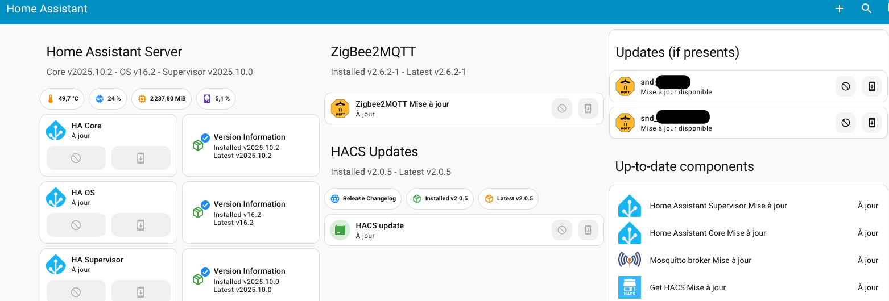

# Dashboard sur les MAJ de composants sur Home Assistant

## Pre-requis

- Un home assistant fonctionnel
- Un HACS fonctionnel

## Mise en place des composants

Installer les intégrations suivantes dans HACS :  

  - **mushroom-title-card** 
  - **mauto-entities**
  - **stack-in-card**

## Configuration

Créer un nouveau tableau de bord et copier y le contenu du fichier dashboard.yaml.  

## Résultat

